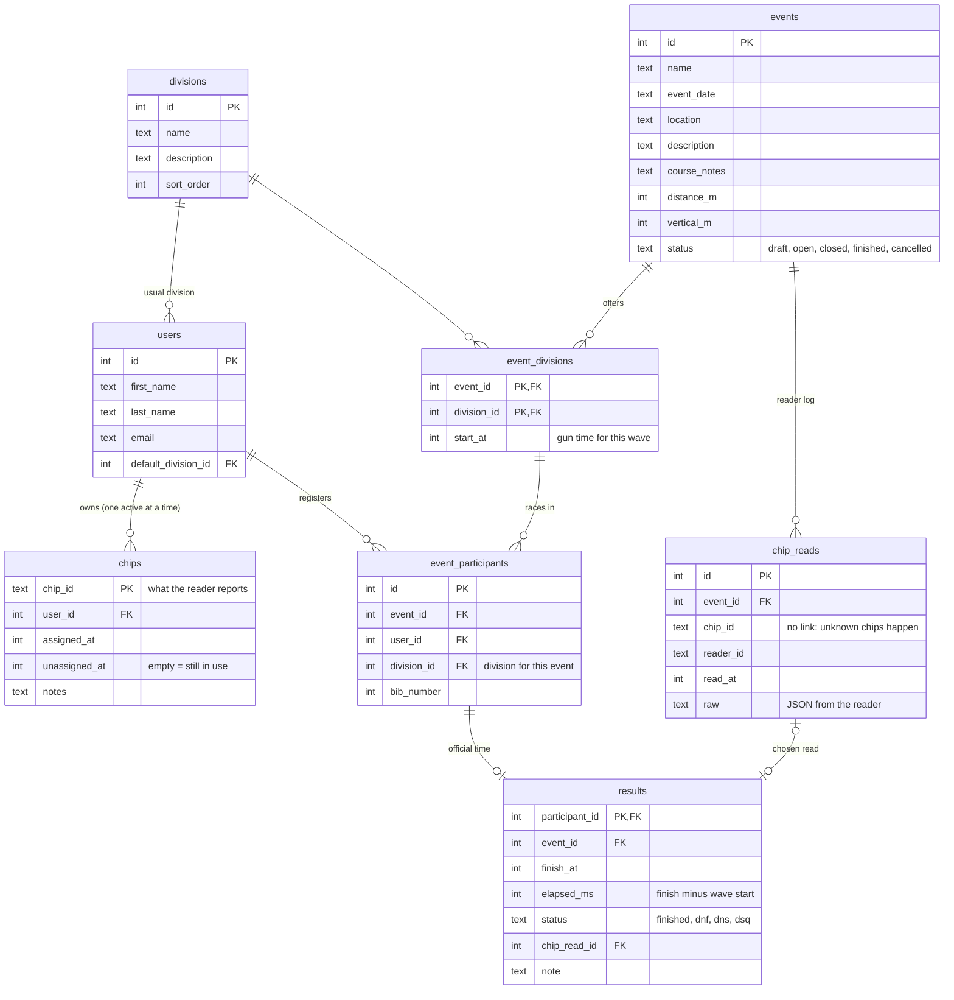

# skimo-timing

A chip timing system for a ski mountaineering race league. This page explains
how the data is organized, in plain terms, so you can check it matches how the
league actually runs. The exact definition lives in [`db/schema.sql`](db/schema.sql)
(SQLite).

## The short version

- **Racers** are stored once and reused every season. Each racer has a name,
  an optional email, and the division they usually race in.
- **Chips** belong to a racer for life. If a chip is lost or swapped, we close
  out the old one and record the new one, so old reads never get credited to
  the wrong person.
- **Divisions** (Race, Rec, Heavy Metal, Youth, and so on) are a league-wide
  list. Racers pick their own division; nothing is enforced by age or gender.
- **Events** are individual race days. Each event says which divisions it
  offers and when each division's wave started.
- **Registering** a racer for an event records which division they are racing
  *that day*. It defaults to their usual division but can be changed per event
  without touching their profile.
- **Chip reads** are everything the finish-line reader saw, untouched. This is
  the evidence.
- **Results** are the one official finish time per racer per event, worked out
  from the reads. Overall and division placings are calculated from results,
  never typed in, so fixing one time fixes the standings automatically.

## How the pieces connect

Read the lines as "one of these has many of those". For example, one event
offers many event divisions, and one racer registers for many events.

## A race day, step by step

1. **Before the season**: add any new racers and their chips. Set each
   racer's usual division.
2. **Create the event**: name, date, location, course notes, distance and
   vertical. Pick which divisions it offers.
3. **Register racers**: each registration picks a division for that day and a
   bib number. Someone who normally races Race but wants an easy day picks Rec
   for this event only.
4. **Start the waves**: record the gun time for each division. Elapsed time is
   measured from the racer's own wave start, so a Rec wave that goes off five
   minutes after Race is handled correctly.
5. **Finish line**: the reader logs every chip it sees, including repeats and
   chips it does not recognize. Nothing here is ever edited.
6. **Build results**: for each registered racer, take the first read of their
   active chip after their wave start. That read is recorded as the official
   finish, with a pointer back to the read it came from.
7. **Standings**: overall place and division place are computed on the fly.
   Racers with a DNF, DNS or DSQ status sort to the bottom.

## Things worth knowing

- **Fixing a time.** Edit the racer's result row and leave a note saying why.
  Placings update themselves. The original reads are still there if anyone
  asks.
- **Lost or replaced chip.** Mark the old chip as unassigned and add the new
  one. A racer can only have one active chip at a time, so every read maps to
  exactly one person.
- **A racer forgets their chip.** Register them as usual, then after the race
  enter their finish time by hand on the result row with a note. There will be
  no chip read to point at, and that is fine.
- **Unknown chips at the finish.** They stay in the read log. If it turns out
  to be a racer with a new chip, add the chip to their profile and rebuild
  results.
- **Times are kept to the millisecond** and stored as plain numbers, so there
  is never any time zone confusion.

## Not covered yet

These were deliberate choices to keep the first version small. Each is a
straightforward addition later.

- Split times or multi-lap races (one finish time per racer for now).
- Divisions based on age or gender (racers self-select).
- Season-long points or series standings.
- Teams or relays.
